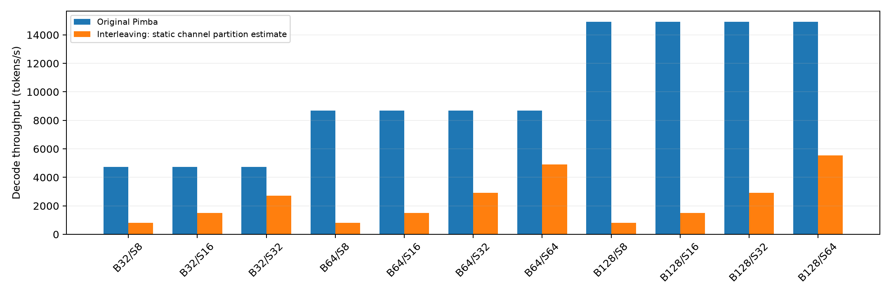
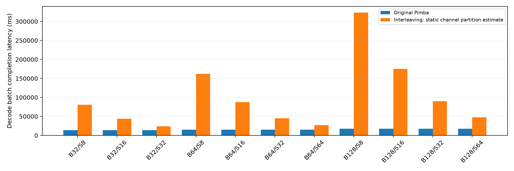
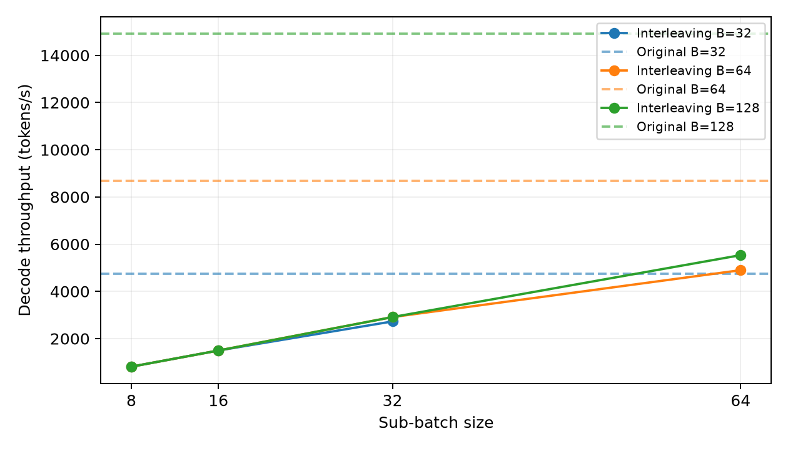
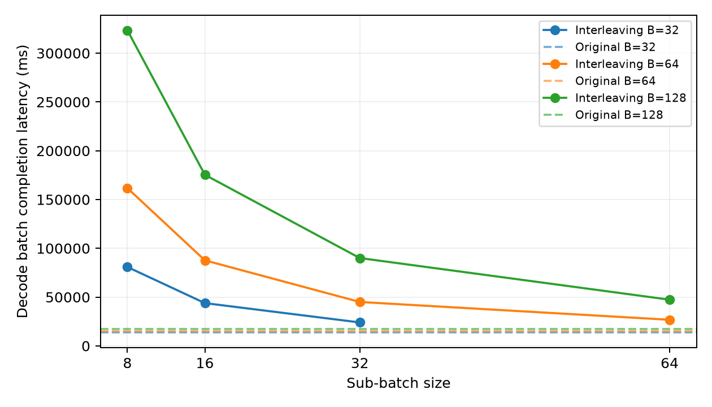
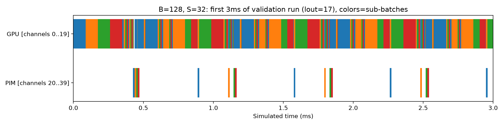
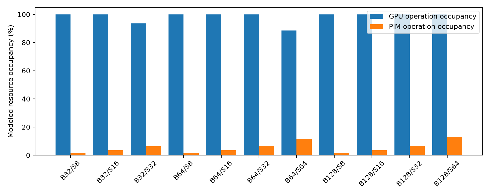

# 实测结果：静态 channel 分区的 Sub-batch Interleaving 原型

原始 Pimba 已成功运行；事件驱动的 interleaving 原型已实现并通过回归。**本次所有11个组合的 throughput 均低于原始 Pimba。** overlap 的调度收益真实存在，但无法抵消小 batch 的 GPU 成本与静态资源分区损失。

数值来自实际执行原 Pimba GPU 模型、原 C++ PIM command-timing simulator 和新增事件 scheduler。它们是**受限系统模型的模拟结果，不是硬件测量，也不是 GPU/PIM 联合 cycle-accurate 验证**。默认 GPU20/PIM20 channels；硬件总数仍40，SPU/MX8和DRAM timing未修改。

## 正式对比

Mamba2-2.7b，A100×1，lin/lout=2048/2048，2047个decode steps。latency 指整个 batch 的这些 decode steps 全部完成的时间，**不包含 prefill、首 token 或队列时间**。速度提升=modified/original throughput；latency reduction为负表示变慢。

| Model | Batch | Sub-batch | Original tokens/s | Modified tokens/s | Speedup | Original latency ms | Modified latency ms | Latency reduction |
|---|---:|---:|---:|---:|---:|---:|---:|---:|
| mamba2-2.7b | 32 | 8 | 4733.09 | 810.31 | 0.171× | 13839.59 | 80837.89 | -484.11% |
| mamba2-2.7b | 32 | 16 | 4733.09 | 1494.32 | 0.316× | 13839.59 | 43835.42 | -216.74% |
| mamba2-2.7b | 32 | 32 | 4733.09 | 2726.99 | 0.576× | 13839.59 | 24020.59 | -73.56% |
| mamba2-2.7b | 64 | 8 | 8694.96 | 810.31 | 0.093× | 15067.12 | 161675.78 | -973.04% |
| mamba2-2.7b | 64 | 16 | 8694.96 | 1494.32 | 0.172× | 15067.12 | 87670.84 | -481.87% |
| mamba2-2.7b | 64 | 32 | 8694.96 | 2911.01 | 0.335× | 15067.12 | 45004.26 | -198.69% |
| mamba2-2.7b | 64 | 64 | 8694.96 | 4898.39 | 0.563× | 15067.12 | 26745.13 | -77.51% |
| mamba2-2.7b | 128 | 8 | 14923.93 | 810.31 | 0.054× | 17556.77 | 323351.56 | -1741.75% |
| mamba2-2.7b | 128 | 16 | 14923.93 | 1494.32 | 0.100× | 17556.77 | 175341.68 | -898.71% |
| mamba2-2.7b | 128 | 32 | 14923.93 | 2911.01 | 0.195× | 17556.77 | 90008.50 | -412.67% |
| mamba2-2.7b | 128 | 64 | 14923.93 | 5534.54 | 0.371× | 17556.77 | 47341.92 | -169.65% |

## 每个 batch 的最佳已测试 size

- Batch32：size32，2726.99 tokens/s；相对原始吞吐下降 42.38%，latency增加 73.56%。TPOT 6.7609 → 11.7345 ms/token。
- Batch64：size64，4898.39 tokens/s；相对原始吞吐下降 43.66%，latency增加 77.51%。TPOT 7.3606 → 13.0655 ms/token。
- Batch128：size64，5534.54 tokens/s；相对原始吞吐下降 62.91%，latency增加 169.65%。TPOT 8.5768 → 23.1275 ms/token。

Batch32/S32、Batch64/S64只有一个 sub-batch，因此没有跨 sub-batch overlap；它们仍承受分区和handoff成本。若要求至少两个 sub-batch，batch32最佳S16（1494.32 tokens/s），batch64最佳S32（2911.01），batch128最佳S64（5534.54）。较大的size在此已测试集合中更好，不能外推为所有模型的最优值。

## 分离 overlap 与其它成本

同样 B128/S32、20/20分区、1μs同步和完全相同profile，关闭overlap时 2726.99 tokens/s、96082.34ms；开启后 2911.01 tokens/s、90008.50ms。吞吐提升 6.75%，latency下降 6.32%；overlap占makespan 6.75%。因此实现不是将两段时间机械取max。

这些对照只证明此模型内事件重叠有效；不能把同分区串行对照替换成 Original Pimba 来宣称超过 baseline。

## 性能原因与资源统计

1. **throughput未提升，latency未下降**：原始大batch GPU GEMM能够复用权重和提高线程块利用率。拆batch导致权重重复读取、tile/SM利用率变化。所有size都重新调用原GPU模型，而不是线性切分时间。
2. **静态分区竞争代价很大**：GPU只保留一半channels/带宽，PIM也用20channels重新跑trace，部分PIM latency增加。独立channel避免同bank冲突，但不能免费使用两套完整HBM。
3. **GPU成为几乎持续忙碌的资源**：B128/S64 GPU operation occupancy近100%，PIM约12.99%，overlap约12.99%。这里的GPU忙碌含memory等待与staging，不意味着SM算力饱和。瓶颈表现为GPU服务需求，尤其权重带宽；不能仅凭这些统计声称瓶颈从原PIM转移，因为原baseline也以GPU耗时为主。
4. **GPU idle减少不等于性能提升**：B128/S32，GPU idle接近0，但总latency显著增加。PIM绝对idle时间反而变长，不能只看GPU utilization。
5. **不同batch不一致**：小sub-batch的modified吞吐接近相同，而原始吞吐随batch增大，因此大batch相对损失更严重。拆分成更多sub-batch未产生更多可用GPU带宽。
6. **未来adaptive方向**：可根据ready queues、tile利用率与GPU/PIM服务需求选择size或直接关闭interleaving；动态channel借用必须新增安全切换与state放置/搬运模型，再实验验证。当前数据不能支持“adaptive一定加速”。

| B128 配置 | GPU idle ms | PIM idle ms | GPU占用 | PIM占用 | overlap |
|---|---:|---:|---:|---:|---:|
| Original | 3074.1824 | 14482.5839 | 82.49% | 17.51% | 0% |
| Modified S32 | 0.0056 | 83934.6501 | 100.00% | 6.75% | 6.75% |
| Modified S64 | 0.0205 | 41193.5576 | 100.00% | 12.99% | 12.99% |

Original 的busy/idle由原串行category服务时间推导；Modified由event区间累计，并在短序列测试中独立重建交集。未导出完整GPU时钟模型，故报告时间而非虚构idle cycles。GPU HBM分区利用率在CSV/JSON中，PIM及全系统memory bandwidth utilization未实现。

## 敏感性：B128/S32，完整2047 steps

| 配置 | tokens/s | Decode latency ms | overlap |
|---|---:|---:|---:|
| sync0ns，GPU20/PIM20 | 2945.31 | 88960.44 | 6.83% |
| sync1000ns，GPU20/PIM20 | 2911.01 | 90008.50 | 6.75% |
| sync5000ns，GPU20/PIM20 | 2781.46 | 94200.75 | 6.45% |
| sync1000ns，GPU24/PIM16 | 3361.17 | 77953.89 | 9.71% |
| sync1000ns，GPU16/PIM24 | 2424.04 | 108090.41 | 5.31% |

GPU分配更多channels的实测结果较好，支持GPU带宽受限的解释；PIM24时SU会按完整wave填充dummy slots，不能把此比较解释为纯粹的连续带宽函数。同步从0到5000ns会降低吞吐，但0同步也远低于原始baseline。

## 正确性、可重复性与原始证据

- 6项regression通过：关闭开关后batch32/64/128的time/energy全部逐category精确相等；依赖/资源互斥/节点唯一完整；尾batch与state递归；单sub-batch；无效配置；同步敏感性。
- 每个完整实验都真正推进全部token/decoder/operator events，并检查预期/实际节点数、state版本与busy-overlap恒等式。B128/S32完成4,716,288 operations，B128/S8完成18,865,152 operations。
- 原始与modified归档PIM trace独立replay，cycles/num_act/num_comp/num_rdwr全部精确一致。原始PIM B128统计与原始源代码、binary hash均保留。
- 基线JSON不可覆盖，SHA256校验保存。每个实验独立进程；CPU simulation runtime与模拟latency分开。完整wall_seconds见CSV和原JSON，无统计随机误差的置信区间声明；这些模型为确定性服务时间计算。

文件：`results/run-20261028/full2048/comparison.csv`、`comparison.json`、每case JSON、原始logs/trace/config/stats；`tests-final.log`和`replay-*.log`。短序列结果在父目录，旧失败日志未删除。

## 图表

图表均由归档JSON生成；前四图另有PDF。timeline来自lout17验证实验的前3ms，颜色为sub-batch，不冒充2048长度的完整timeline。

## 可信范围与未完成项

可信结论是：**在当前静态分区、原Pimba服务模型及明确的交接假设下，interleaving真实发生，但本矩阵总性能退化。** 不是对所有可能GPU/PIM interleaving架构的否定。

尚未完成：共享channel普通GPU RD/WR与PIM commands的联合C++ timing；跨trace持续refresh/controller状态；物理state/address/capacity allocator和MX metadata；真实异步PIM命令提交硬件；numerical inference/accuracy；RetNet/Zamba2；adaptive调度。未把NeuPIMs双row buffer引入Pimba，也没有声称这些功能已经cycle-accurate实现。详见 IMPLEMENTATION.md。
